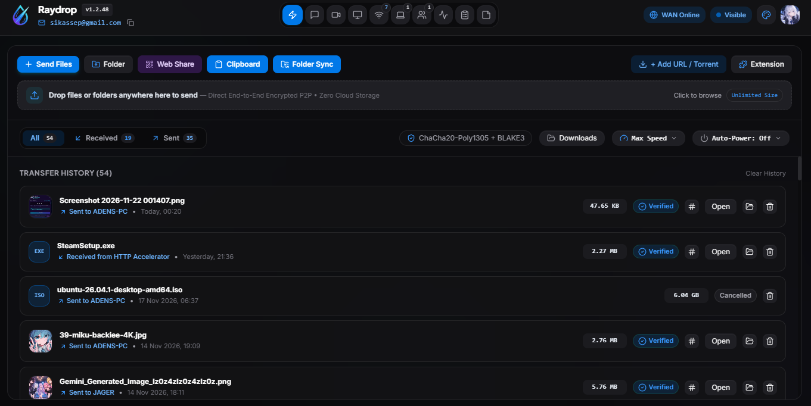
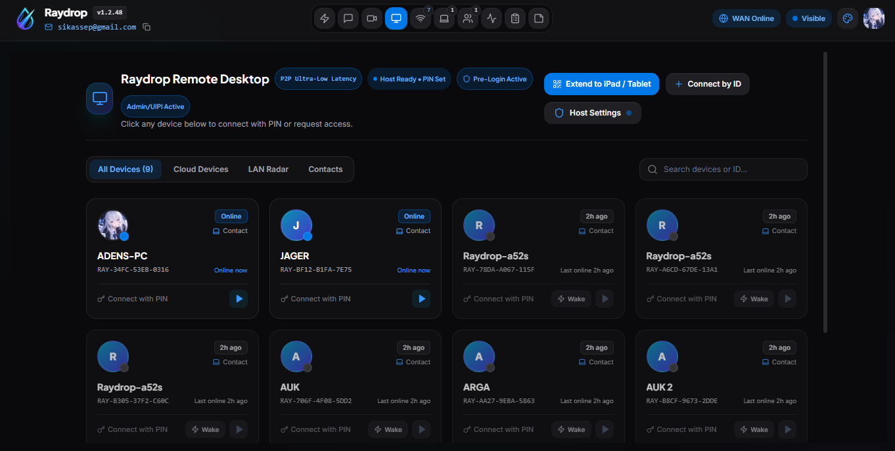
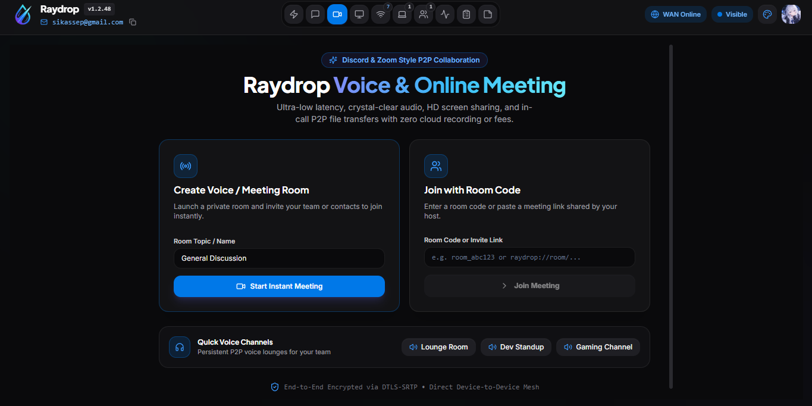
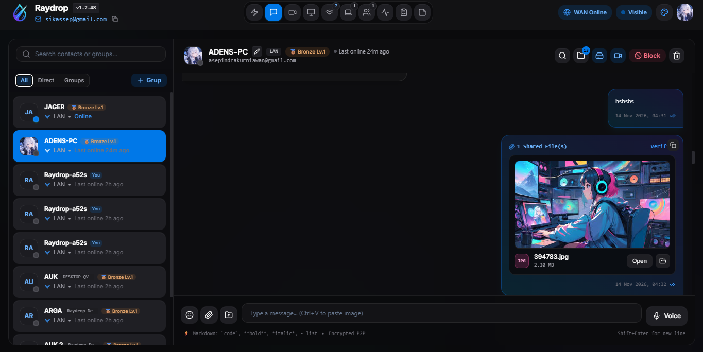
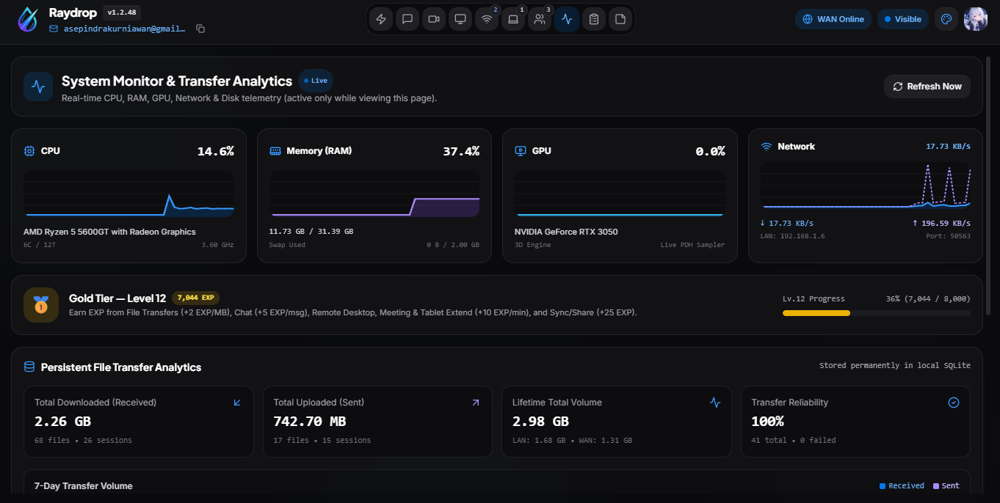
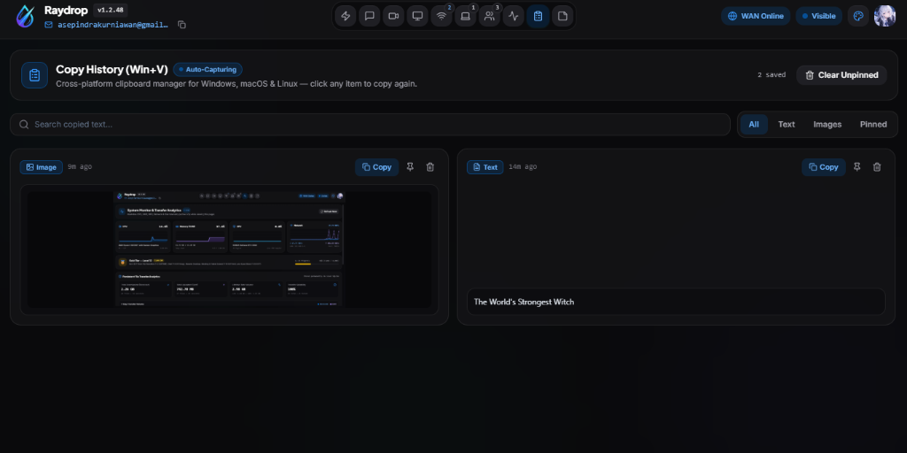

<p align="center">
  
</p>

<h1 align="center">Raydrop</h1>

<p align="center">
  <strong>Universal P2P Collaboration & High-Speed File Transfer Suite (LAN + Direct WAN)</strong><br />
  Fast, Resumable, End-to-End Encrypted File Sharing, Real-Time Folder Sync, Voice Notes & Zero-Cloud Online Meetings.
</p>

<p align="center">
  <a href="https://github.com/asepindrak/raydrop/releases/latest"></a>
  <a href="LICENSE"></a>
  <a href="https://tauri.app/"></a>
  <a href="https://www.rust-lang.org/"></a>
  <a href="https://svelte.dev/"></a>
  
  
</p>

<p align="center">
  <a href="#-download"></a>
  <a href="#-download"></a>
  <a href="#-download"></a>
  <a href="#-download"></a>
</p>

---

## 🌟 Overview

**Raydrop** is an open-source, privacy-first peer-to-peer (P2P) collaboration and file transfer suite built with **Tauri v2 (Rust + Svelte 5 + Tailwind CSS)**. 

Unlike traditional file-sharing or cloud meeting services that upload your personal data to third-party servers, Raydrop establishes **direct, encrypted point-to-point connections** between devices across local Wi-Fi/LAN or over the public internet. 

**Your files, voice data, screen streams, and metadata NEVER touch the cloud.**

### 🌟 What Makes Raydrop Unique?
- 🔌 **OpenAI-Compatible Multi-CLI LLM Bridge & P2P Relay:** Expose local coding-agent CLIs (Antigravity `agy`, Claude Code, Codex, Gemini CLI, OpenCode) as standard OpenAI-compatible `/v1/chat/completions` & `/v1/models` endpoints on dynamic ports (`48811–48815`), with Tailscale IP detection, Public/Private access toggle, live peer bridge discovery, and encrypted P2P WAN/LAN relay.
- 🧩 **AI-Assisted MCP Library & Popular Presets:** Paste any MCP URL, GitHub repo, CLI command, or JSON config—Raydrop probes the endpoint, detects API key/auth requirements, tests live `tools/list`, installs directly to 8+ coding agents (`Antigravity`, `Claude Code`, `Cursor`, `Gemini CLI`, `Codex`, `Windsurf`, `OpenCode`, `Cline`) and enables them inside RayBot & Telegram Bot. Includes 15+ popular presets (MySQL, PostgreSQL, SQLite, Supabase, Context7, Playwright, GitHub, Figma, Notion, Brave Search, Firecrawl).
- 🧠 **AI Skills Library (Universal Coding-Agent Skills Manager):** Discover, scan, import (GitHub, local folder, ZIP), auto-sync entire GitHub skill repositories (`anthropics/skills`, `vercel-labs/agent-skills`, `obra/superpowers`), and safely install `SKILL.md` packages globally or per-project across 10+ coding agents—with static security heuristics, backup & rollback, and pre-existing skill auto-discovery.
- 🎵 **RayAmp (Winamp-Style Audio/Video Player & YouTube Music):** Floating deck with Web Audio spectrum visualizer, local MP3/FLAC/MP4/MKV, persistent SQLite Queue & Playlists with drag-and-drop reorder, YouTube Music search, compact Video mode, and automatic zero-config `yt-dlp` stream engine setup.
- 🤖 **Full MCP Server & Telegram AI Bot:** Built-in JSON-RPC MCP server (`http://127.0.0.1:48765/mcp`) plus a native Telegram AI Bot with multi-user whitelist, customizable Bot Persona, and preset/custom OpenAI-compatible LLM providers (OpenAI, Gemini, Claude, DeepSeek, Groq, OpenRouter, Ollama).
- 🖥️ **Unattended P2P Remote Desktop (Pre-Login Windows Service):** Full 60fps remote control with Windows `SYSTEM` service for pre-login Lock/PIN screen access, native zero-prompt capture, WASAPI system audio streaming, multi-monitor switching, remote power controls, and auto-minimize on connect.
- 📱 **Extend to iPad / Tablet via QR Code:** Turn any iPad, iPhone, or Android tablet into a wireless touch-enabled second display via Safari/Chrome—no app installation required.
- ⚡ **Wake-on-LAN (WoL) & Instant Media Streaming:** Wake offline PCs with UDP Magic Packets and stream actively downloading videos before completion.
- 🚀 **Parallel P2P Transfer Engine:** Multi-segment streaming with auto-resume (`.raypart`) and BLAKE3 integrity verification.
- 👥 **Encrypted Group Chat & Admin Roles:** Multi-user group chats with syntax-highlighted code blocks, variable-speed voice notes ($1\times$–$2\times$), and live "Last Online" presence.
- 🎨 **Carbon Azure & Custom Themes:** Sleek matte Carbon Azure default theme plus Midnight Slate, OLED True Black, Cyberpunk Neon, and Clean Light themes; Laser Pointer & Screen Annotation; and Floating Mini Player (PiP).
- 📊 **System Monitor & Transfer Analytics Dashboard:** Live Task Manager-style CPU, RAM, GPU, Disk, and Network charts with persistent lifetime transfer analytics.
- 🏆 **Raydrop Rank & EXP Progression:** Level up from Bronze to Mythic by transferring files, chatting, hosting meetings, using Remote Desktop, and extending to tablets—with rank badges shown in Contacts, Chat, and Meetings.
- 📋 **Cross-Platform Copy History (Win+V) & Keep-Style Notes:** Automatic clipboard history for Windows, macOS, and Linux plus Google Keep-style notes with `Ctrl+V` image paste and interactive task checklists.
- 🔒 **Hidden & Offline Private Mode:** Switch from Visible to `Hidden • Offline` to disconnect WAN signaling and unregister LAN mDNS immediately.
- 📋 **Direct Clipboard Image Paste:** Paste screenshots (Ctrl+V) directly into conversations with image preview cards and caption support.
- 🔄 **Continuous Real-Time Folder Mirroring:** Automated background folder sync that monitors filesystem changes and mirrors files without manual intervention.
- 📂 **Remote Folder Browser:** Securely explore authorized folder structures on paired peer devices and pull files on demand.
- 🎧 **Zero-Cloud Online Meetings & Voice Rooms:** Host Discord & Zoom-like encrypted meetings with 1080p 60fps screen sharing, voice activity detection, and in-meeting file drop.
- 🎙️ **Quick Voice Notes:** Record and send crisp audio notes directly in chat with in-app audio waveform players.
- 💬 **P2P Encrypted Chat & Clipboard Sync:** Rich Markdown messaging, media sharing, and instant cross-device clipboard sync.
- ⚡ **IDM-Style Download Accelerator & BitTorrent:** Accelerated web downloads (4–8 segments) with official Chrome/Edge extension and embedded BitTorrent engine.
- 👤 **Persistent Multi-Device Avatar Sync:** Upload personalized profile pictures with automatic real-time synchronization across all your linked devices.

---

## 📸 Screenshots

| P2P File Transfer & Accelerator | P2P Remote Desktop |
| :---: | :---: |
|  |  |

| Online Meeting & Voice Rooms | Encrypted P2P Chat |
| :---: | :---: |
|  |  |

| System Monitor &amp; Transfer Analytics | Copy History (Win+V) |
| :---: | :---: |
|  |  |

---

## ✨ Key Features

### 🆕 Snipping-Tool Image Editor, RayAmp Now-Playing, Remote RayBot & Mobile Fixes (New in v1.2.98)
- **Snipping-Tool Image Editor in Copy History:** Edit captured images directly in Copy History with Pen, Highlighter, Eraser, Arrow, Rectangle, Circle, Blur/Redact, Text, Crop, Undo/Redo, Save PNG, and Save & Copy.
- **RayAmp Now-Playing Broadcast (Discord-Style) & Mobile Media:** Broadcast your active RayAmp track to contacts & devices (`🎵 Listening to ...` in Contacts & Chat), full-width mobile RayAmp layout, and Android local audio/video file picker support.
- **Remote RayBot Device Switcher:** Switch target device in RayBot Chat UI across your own online devices (e.g. chat from Android to run coding/tools on your PC's RayBot).
- **Remote Desktop WebRTC Reconnect Fix, Global Toast Notifications, Share Contact & Mobile Polish:** Fixed `createOffer ... signalingState is 'closed'` on reconnect and long-idle freeze, fixed mobile Profile button & APK v1/v2/v3 signing, completed Customize Bottom Menu, added Share Contact, global toast notifications, and fixed LLM Bridge button overflow.

### 🆕 Startup Freeze & WebView2 CPU Hotfix (New in v1.2.97)
- **Zero-Idle-CPU RayAmp Visualizer:** Stopped the 60fps `requestAnimationFrame` canvas gradient loop when RayAmp is paused/idle or hidden, eliminating background WebView2 GPU/Renderer CPU spikes on Windows.
- **Non-Blocking Startup & Throttled Polling:** Moved `llm_bridge::init_from_db` (`where` CLI detection) off the Tokio async worker into `spawn_blocking`, disabled UI torrent/HTTP broadcast loops inside `--system-agent`, and relaxed frontend status/LAN polling from `4–5s` to `10s`.

### 🆕 RayBot Coding Workspace, CLI Modes, ComfyUI & Language Tutor (New in v1.2.96)
- **RayBot Persistent Coding Workspace & Cross-Project Relations:** Set a projects root folder (default `~`), auto-scan projects & tech stacks, track persistent cross-project relations (`raybot_projects`, `raybot_project_relations`), and code directly from RayBot Chat UI or Telegram Bot using scoped `project_*` and `code_*` MCP tools.
- **Direct RayBot Skills, MCP & Language Tutor Skill:** Install Skills & MCP servers directly onto RayBot across any LLM provider (Ollama, LM Studio, KoboldCPP, OpenAI, Gemini, Claude, LLM Bridge), including a built-in `language-tutor` skill with dynamic CEFR syllabus and persistent per-language SQLite progress.
- **LLM Bridge CLI Execution Modes & Extra Flags:** Per-provider headless execution modes (`YOLO`, `Auto-Edit`, `Safe` with read-only prompt guard) across `agy`, `claude`, `codex`, `gemini`, and `opencode`/custom CLIs, plus custom extra flags.
- **Image Bridge, Local Vision & ComfyUI + Waifu Persona:** Host-side image storage & local path forwarding to CLIs, automatic Local LLM vision routing, ComfyUI image generation in RayBot Chat UI & Telegram Bot, and a new **Waifu Companion** persona style.

### 🆕 Multi-CLI LLM Bridge, AI MCP Library & GitHub Skills Sync (New in v1.2.95)
- **OpenAI-Compatible Multi-CLI LLM Bridge:** Turn local coding CLIs into OpenAI-compatible `/v1/models`, `/v1/chat/completions`, and `/v1/images/generations` endpoints on dynamic ports (`48811–48815`), with Tailscale IP support, Public/Private contact access toggle, live peer bridge discovery, and P2P WAN/LAN relay proxies.
- **AI-Assisted MCP Library & 15+ Popular Presets:** Paste any MCP endpoint URL (e.g. `https://mcp.sehatierp.com/`), GitHub repo, `npx`/`uvx` command, or JSON—Raydrop auto-detects transport (`http`/`sse`/`stdio`) and API key fields, runs live `Test Connection`, installs to 8+ Coding Agents, and plugs external MCP tools straight into Raydrop Bot & Telegram Bot. Ships with 15+ built-in presets including **MySQL**, **PostgreSQL**, **SQLite**, **Supabase**, **Context7**, **Playwright**, **GitHub**, **Figma**, **Notion**, **Brave Search**, and **Firecrawl**.
- **GitHub Repo Auto-Sync & Built-in Skills:** One-click **Sync** for GitHub skill repositories (`anthropics/skills`, `vercel-labs/agent-skills`, `obra/superpowers`), plus built-in `performance-optimization-skill` & `reverse-engineer-anything` and Windows read-only (`os error 5`) sync hardening.
- **Remote Power Controls in My Devices:** Trigger remote Sleep, Restart, or Shutdown directly from the My Devices view for authorized devices.

### 🆕 AI Skills Library, Meeting Video Recording & RayAmp Upgrades (New in v1.2.80)
- **Local-First AI Skills Library:** Manage coding-agent skills (`SKILL.md`) across 10+ agents (`Codex`, `Claude Code`, `Cursor`, `Gemini CLI`, `OpenCode`, `GitHub Copilot`, `Windsurf`, `Cline`, `Roo Code`, `Continue`) with GitHub/ZIP/Folder import, static security scanning, Global & Project scope install/uninstall, auto-scan of pre-existing skills on disk, update diffing, and 1-click backup rollback.
- **Full Meeting Video + Audio Recording:** Composites local camera/screen share and all remote participants onto a 720p@24fps canvas mixed with Web Audio (`AudioContext`) into a single `.webm` recording.
- **Persistent RayAmp Queue & Compact Video Mode:** Persists the active playback queue and order in local SQLite across restarts, supports drag-and-drop queue/playlist reordering, hides the equalizer in Show Video mode for more playlist space, and cleanly stops playback when quitting from the system tray.
- **Chat Voice & Image Caption Fixes, Mobile Touchpad & Single-Instance Hardening:** Fixes clipboard image + text caption rendering, reliable voice note recording/sending, mobile touchpad gestures (1-finger click, 2-finger right-click & scroll), Xbox/gamepad home button forwarding in Game Mode, and strict single-instance SQLite WAL protection.

### 🆕 RayAmp Media Player, Full MCP Server & Telegram AI Bot (New in v1.2.77)
- **RayAmp Winamp-Style Audio & Video Player:** Draggable floating deck with real-time Web Audio spectrum visualizer, Audio/Video mode toggle, Queue & persistent SQLite Playlists, YouTube Music search (`Songs` / `Videos`), and automatic background `yt-dlp` installation for zero-config streaming.
- **RayDrop Full MCP Server (HTTP / JSON-RPC):** Exposes RayAmp playback/playlists and core RayDrop tools (`devices_list`, `device_wake_on_lan`, `system_telemetry`, `clipboard_get_history`, `notes_list`, `notes_create`, `shared_folders_list`) with optional Bearer Auth token.
- **Telegram AI Bot with Multi-User Whitelist & Bot Persona:** Built-in long-polling Telegram bot (`@BotFather` token + multiple allowed numeric User IDs) connected to full RayDrop MCP tools, customizable Bot Persona (name, style preset, language, custom system instructions), and support for **OpenAI, Google Gemini, Anthropic Claude, DeepSeek, Groq, OpenRouter, Ollama**, or any **Custom OpenAI-Compatible** endpoint.
- **Wake-on-LAN Settings & English Setup Guide:** Configure per-device MAC, DDNS host, and UDP port directly in Settings with automatic local MAC detection and a built-in BIOS/OS/Free-DDNS setup guide.

### 🆕 Productivity, Analytics & Privacy Suite (Updated in v1.2.62)
- **WAN Direct QUIC STUN Fix & 2 GB Relay Fallback Guard:** Awaits STUN reflexive address discovery before sending `CONNECT_INTENT` / `CANDIDATE_ANSWER`, releases Windows UDP hole-punch sockets cleanly before QUIC handshakes, and raises the fallback WSS Relay limit from `100 MB` to `2 GB` for strict Symmetric NAT / CGNAT networks.
- **Per-Account Isolated Local Databases & Device Name Persistence:** Switching accounts on the same PC now isolates Transfer History, Chats, Groups, Contacts, Clipboard History, Notes, and Device Names (`storage_user_<id>.db`), and prevents permanent transfer errors (e.g. `> 100 MB` WAN relay guard) from looping at checkpoint.
- **Non-Contact Incoming Chat Visibility & Daily Update Snooze:** Displays incoming chats from users not yet in your Contacts list (auto-adding them when you reply) and limits automatic update popups to once every 24 hours unless manually checked.
- **Zero-Prompt Windows Remote Capture & Mobile UI Polish:** Prioritizes native Windows GDI capture so Remote Desktop connects automatically with zero screen-share picker popups even with multiple monitors (`MttVDD`), wraps the mobile Remote Desktop & Meeting toolbars cleanly without overflow, and opens Mobile Chat on the Contacts list first.
- **Mobile Metro Tile Hub, Pre-Login Zero-Prompt Remote Fix & Transfer Status Badges:** Replaces mobile bottom nav with a responsive Windows-Phone-style Metro Tile home hub giving 1-tap access to all 11 features, fixes post-reboot Winlogon/multi-monitor share-screen popups on Remote Desktop, and displays clear `Rejected`/`Paused` badges in Transfer History.
- **Linux X11 Automatic Virtual Display (`xrandr` + `cvt`):** Automatically creates and cleans up a virtual 2nd monitor on Linux X11 (Intel/AMD without `sudo`) with resolution switching and concise English guidance for Wayland, NVIDIA Xorg, and macOS.
- **Live Cursor on Extended Display, Clean Remote Audio & Sleek Icon Controls:** Draws the live Windows cursor directly onto Display 2 (`MttVDD`) for iPad/Laptop Extend, eliminates idle "bip-bip" audio artifacts via WASAPI silence gating & single-stream playback, and upgrades Extend viewer `Fill Screen / Fit Aspect` & `Fullscreen` buttons with SVG icons.
- **Extend Display Resolution Switcher, Right-Side iPad Controls & Laptop/MacBook Mouse Support:** Switch Display 2 resolution (`800×600` to `3840×2160`) directly inside Raydrop's Extend modal, use the right-edge drawer handle (`Fit Aspect` / `Exit Fullscreen`) on iPad Safari without top-bar conflicts, and control the extended screen with mouse & trackpad from any Laptop or MacBook browser.
- **Native GDI Extended Display Capture (`MttVDD` Black-Screen Fix):** Extended 2nd Monitor streaming to iPad/Tablet now uses native Windows GDI region capture directly from Rust, eliminating Chromium `getDisplayMedia()` black-screen issues on virtual displays (`MttVDD`), with instant Display 1 ↔ Display 2 switching and zero browser picker popups.
- **Auto-Installed Virtual Display Driver & Lag-Free Long Sessions:** Windows `.msi` installer automatically bundles and installs `MttVDD` (skipping if already installed) for instant **Extend to iPad / Tablet**, paired with instant Stop Streaming, DataChannel backpressure, Extend Display frame-skipping, and 1080p@30fps WebRTC tuning to keep long sessions smooth.
- **Smart Clipboard History Cap (Max 30 Unpinned):** Automatically prunes the oldest unpinned clipboard entries past 30 items while keeping all pinned items intact.
- **File Converter, Image Resizer/Compressor & Mobile Icon Pack (ZIP):** Convert images batch-wise (`PNG ↔ ICO / JPG / WEBP / BMP / GIF`), resize & compress with quality controls, generate complete Android (`mipmap-*` + Play Store 512px) & iOS (`AppIcon.appiconset` + `Contents.json`) icon packs in one `.zip`, convert `DOC/DOCX ↔ PDF` (via Microsoft Word / LibreOffice), and launch directly from the OS Explorer right-click menu (**Convert / Optimize with Raydrop**).
- **Explorer Image File Clipboard Sync (`CF_HDROP`):** Copy an image file directly in Windows Explorer (`Ctrl+C`) and paste it into the Remote Desktop Host seamlessly.
- **Smooth Startup Initialization Overlay & Dynamic Versioning:** Displays a clean fullscreen loading overlay until all P2P modules, contacts, and transfer history are ready, with live Tauri app version detection.
- **Transfer History Delete & Clear History:** Delete individual entries or clear completed records from Transfer History while preserving persistent lifetime analytics.
- **System Monitor & Persistent Transfer Analytics Dashboard:** Monitor live CPU, RAM, GPU, Disk, and Network throughput charts (loaded lazily when opened) alongside persistent local analytics for total gigabytes sent and received.
- **Raydrop Rank & EXP Badges:** Earn EXP across File Transfers (`+2 EXP/MB`), Chat (`+5 EXP/msg`), Remote Desktop, Meetings, Tablet Extend (`+10 EXP/min`), and Sync/Share (`+25 EXP`). Rank badges (`Bronze` → `Mythic`) appear in your Profile Menu, Contacts, Chat, and Meeting tiles.
- **Cross-Platform Copy History (Win+V):** Persistent clipboard history for Windows, macOS, and Linux—automatically captures copied text and images, supports search, Pin/Unpin, and 1-click re-copy.
- **Notes & Task Lists (Google Keep Style):** Create color-coded notes, interactive task checklists, `#labels`, and paste screenshots (`Ctrl+V`) directly into notes.
- **Hidden & Offline Private Mode:** Clicking `Visible` toggles to `Hidden • Offline`, immediately disconnecting WAN signaling, unregistering LAN mDNS, and disabling Remote Desktop initiation until you switch back to `Visible`.
- **WAN Wake-on-LAN (DDNS + Custom Port) & Auto MAC:** Automatically detects and pre-fills MAC addresses across your own devices and supports DDNS hostnames + custom UDP ports for waking PCs over WAN.
- **Native OS Download Notifications:** Triggers Windows/macOS/Linux desktop notifications upon completion for P2P Transfers, HTTP Accelerator downloads, and BitTorrent downloads.

### 🖥️ Raydrop P2P Remote Desktop & Control Suite (Updated in v1.2.49)
- **Pre-Login Windows System Service (`RaydropService`):** Installable in 1 click from Host Settings (`NT AUTHORITY\SYSTEM`), allowing you to connect immediately after a PC reboot, view the Windows Lock/PIN screen (`Winlogon`), and type your Windows login PIN remotely.
- **Native Zero-Prompt Capture & Auto-Minimize:** Captures the Windows desktop silently without browser permission popups and automatically minimizes the Host Raydrop window when a session connects.
- **Native Host System Audio Streaming (WASAPI Loopback):** Streams YouTube, music, and system audio from the Host PC directly to the Remote Client.
- **Extend to iPad / Tablet / Phone via QR Code:** Generates an instant local Wi-Fi QR Code to open a zero-install, touch-enabled wireless second display in Safari or Chrome, with auto-hiding fullscreen controls and a top-center arrow drawer handle.
- **Multi-Monitor Switcher, Remote Power Controls & Drag-and-Drop:** Switch between displays, Lock/Sleep/Restart/Shutdown the host remotely, drag-and-drop files straight onto the remote screen (including fullscreen mode), or pop out into Floating Mini Player (PiP).
- **Fullscreen Keyboard Lock & Zero Ghost Cursor:** Captures `Alt+Tab`, `Win` key, and `PrintScreen` in fullscreen while keeping the client cursor crisp at 0ms latency.
- **High-Resolution 60 FPS Desktop Streaming:** Powered by WebRTC with `maintain-resolution` priority for sharp text and code readability across WAN and LAN.
- **Mandatory PIN Security & Access Control:** Remote connections are gated by a customizable 6-digit security PIN. Only authorized peers who supply the correct PIN can establish a control session, preventing unauthorized remote access on local networks.
- **Automatic Bidirectional Clipboard Sync (Text & Images):** Automatically detects copied text or images on either the Client or Host and syncs them silently in both directions so you can paste immediately without manual toolbar buttons.
- **Low-Latency Input Injection:** Native OS mouse movements, left/right/middle clicks, smooth wheel scrolling, and keyboard keystrokes are transmitted via low-overhead WebRTC DataChannels (<20ms local latency).
- **Desktop Shortcut Toolbar:** Built-in floating controls for Windows key, Task Manager (`Ctrl+Shift+Esc`), Show Desktop (`Win+D`), Lock Host (`Win+L`), and fullscreen switching.
- **Cross-Platform PC & Mobile Ready:** Remote control desktop machines directly from other PCs or mobile devices.

### 👥 P2P Encrypted Group Chat & Granular Admin Permissions (New in v1.2.25)
- **Zero-Cloud Group Channels:** Create multi-member P2P group conversations with full end-to-end encryption across local Wi-Fi mesh and WAN signaling relay.
- **Hierarchical Admin Hierarchy:** Group creator acts as Primary Owner and can promote trusted members to co-admins or demote them.
- **Admin-Only Invitation Security:** Only group owner and admins hold permission to invite new contacts into the group.
- **Configurable Send Permissions:** Admins can configure message sending rules on the fly:
  - **All Members:** Open discussion where every participant can send messages and voice notes.
  - **Admins Only:** Broadcast / announcement channel where only the owner and co-admins can send messages.
  - **Custom Whitelist:** Specific selected members allowed alongside admins. Restricted members see an intuitive lock indicator banner.
- **Self-Healing Group Membership:** Members can exit groups at any time; if the primary owner leaves, ownership is automatically transitioned to the next admin.

### 📋 Direct Clipboard Image Paste in Chat (New in v1.2.25)
- **Ctrl+V Screenshot & Graphic Paste:** Paste captured screenshots, snipped graphics, or copied images directly from your system clipboard into chat.
- **Image Preview Card with Caption Support:** Displays an instant thumbnail preview of the pasted image with optional text captioning before sending.
- **One-Click Clipboard Copy & Fullscreen Lightbox:** Recipient devices can view full-screen zoom previews, copy the raw image back to their system clipboard, or save directly to Downloads.

### 🎧 P2P Online Meeting & Crystal-Clear Voice Rooms (New in v1.2.20 - v1.2.21)
- **Discord & Zoom-Style P2P Room:** Host or join private encrypted meeting rooms directly between peers using WebRTC mesh with zero central audio/video relay servers.
- **1080p 60fps Screen Sharing:** Share entire monitors or specific application windows with pre-negotiated video transceivers (`replaceTrack`) for instant, flicker-free, and disconnection-proof screen sharing.
- **Person-Based Multi-Device Invites:** Group contacts by individual identity rather than cryptic device IDs. Inviting a user broadcasts the invite simultaneously to all of their active online devices, allowing them to choose which device to join from.
- **Voice Activity Detection & Glowing Halo:** Real-time microphone audio level monitoring with dynamic emerald speaker indicators (`isSpeaking`).
- **Interactive In-Room Collaboration:** Built-in meeting chat, instant participant roster, camera/mic controls, and direct file dropping into the room.

### 🔄 Continuous Real-Time Folder Mirroring (Background Sync) (New in v1.2.18)
- **Automated Directory Synchronization:** Native OS filesystem watcher monitors source folders for file creations, modifications, and deletions.
- **Seamless Background Mirroring:** Changes are automatically queued, packaged, and transmitted to paired remote machines in real time without manual re-selection.
- **Conflict & Interruption Resilient:** Automatically handles Wi-Fi disconnections, laptop sleep states, and resumes transfers without duplicating files.

### 🔍 Remote Folder Browser (On-Demand File Pulling) (New in v1.2.18)
- **Direct Remote Exploration:** Securely browse approved remote folder directories on your paired devices (e.g., browse office PC from home laptop).
- **1-Click File Pull:** Download specific files or folder trees on demand directly to your local computer without requiring the remote user to manually attach or send them.

### 🎙️ Quick Voice Note (Perekam Suara Cepat) (New in v1.2.19)
- **One-Click Audio Recording:** Fast in-chat voice recorder with live recording timer, animated waveform visualizer, and discard/send actions.
- **Compact Audio Messaging:** Encoded and delivered via P2P encrypted channels; playable directly inside chat bubbles with custom seekable audio players.

### 🖼️ Transfer History Preloaded Thumbnails & Asset Lightbox (New in v1.2.22)
- **Native Rust High-Speed Thumbnails:** Native image decoding crate generates 320x240 compressed JPEG base64 thumbnails for both incoming and outgoing image transfers.
- **Tauri v2 Asset Protocol & Zoom Lightbox:** Configured `protocol-asset` and asset security scopes enable full-resolution image zoom/pan lightboxes and in-app video/audio players.
- **Clean Fallback Engine:** Gracefully falls back to clean file extension badges (`JPG`, `PNG`, `WEBP`, etc.) when files are moved or deleted, preventing broken browser image icons.

### 🚀 High-Speed & Resumable Transfer Engine
- **Parallel Multi-Segment Streaming (IDM-Style):** Uses up to 6 concurrent parallel chunk streams for large files to maximize bandwidth utilization across local networks and WAN connections.
- **Resumable Transfers (`.raypart`):** If Wi-Fi disconnects or your PC sleeps, transfers seamlessly resume from where they stopped without re-downloading existing chunks from scratch.
- **Streaming BLAKE3 Integrity Checks:** Files are verified on-the-fly using cryptographic BLAKE3 hashes to guarantee bit-perfect delivery.
- **Zero-Latency Handshake:** Senders transmit the manifest instantly without pre-hashing bottlenecks.

### 🔒 Zero-Knowledge & Privacy-First Architecture
- **Zero File Storage on Servers:** The signaling server **never** stores, buffers, inspects, or logs your files, file names, file sizes, or transfer histories.
- **End-to-End Encryption (E2EE):** Every 512 KB chunk is encrypted with `ChaCha20-Poly1305` AEAD using ephemeral session keys negotiated via `X25519` Diffie-Hellman and `HKDF-SHA256` forward secrecy.
- **Cryptographic Device Identities:** Each device generates an `Ed25519` keypair with a tamper-proof Device ID format (`RAY-XXXX-XXXX-XXXX`).
- **Path Traversal Sanitization:** Incoming file paths are strictly sanitized to prevent directory traversal attacks (`../`).

### 🌐 Dual-Mode Connectivity
- **Local LAN Discovery (mDNS):** Automatically detects nearby devices on the same Wi-Fi/LAN via zero-config `_raydrop._tcp.local.`.
- **Direct Internet WAN P2P (STUN / Hole-Punching):** Establishes direct P2P connections across NATs using a lightweight self-hosted STUN reflector and WebSocket signaling server.

### 🖱️ Seamless Operating System Integration
- **Windows Explorer Context Menu:** Right-click any file, folder, or multi-selection and click **"Send with Raydrop"** to instantly queue transfers into the running System Tray background instance.
- **Native OS Multiple Drag & Drop:** Drop multiple files and folders directly from Windows Explorer into Raydrop with a full-window glowing indicator.
- **Auto-Focus Transfer Window:** Selecting files from the file manager automatically brings Raydrop to the foreground with an auto-focused contact selector for 1-click sending.
- **Foreground Alert for Incoming Files:** Automatically raises the modal prompt on the recipient's screen when a transfer request arrives.

### 📂 Rich Transfer Experience
- **Dedicated Full-Width Workspace:** Clean, modern transfers & streams dashboard inspired by minimalist developer design.
- **Direct File Navigation:** Open downloaded files immediately or open the containing folder with the specific file automatically highlighted and focused in Windows Explorer.
- **Manifest Breakdown:** View full lists of received files, sizes, and folder trees.
- **Transfer History & Filter Tabs:** Easily switch between **All**, **Received**, and **Sent** records with timestamps, transfer speeds, and progress indicators.

### 💬 Integrated P2P Encrypted Chat with Media & File Transfer
- **Direct LAN & Remote WAN Messaging:** Real-time end-to-end encrypted messaging with contacts and peers across local Wi-Fi or public internet with zero server database burden.
- **Rich Markdown Formatter:** Full support for syntax-highlighted code blocks, formatting (`**bold**`, `*italic*`), blockquotes, tables, and planning task checklists.
- **Integrated In-Chat File & Media Sharing:** Attach and send multiple images, videos, documents, PDFs, archives, and entire folders directly within the conversation.
- **Real-Time Synchronized Streams:** Files sent in chat leverage Raydrop's multi-stream parallel acceleration and automatically appear in both the chat timeline and the main Active Transfers workspace with live progress indicators.
- **Direct File Launch:** Open shared files directly from chat bubbles with system default apps or reveal them in Windows Explorer with 1 click.
- **Zero Server Storage & Zero Server DB:** Chat history is stored 100% locally on each peer's private SQLite database. The server never stores chat messages or conversation logs.

### ⚡ IDM-Style HTTP Multi-Segment Accelerator & BitTorrent Engine (New in v1.2.15)
- **Profile Avatars & Contact Nicknames:** Personalized device nicknames/initials and persistent avatar syncing across peers.
- **Image Lightbox & Device Inspector:** Direct image thumbnails in transfer history with zoom/pan lightbox, plus complete linked-device inspector in contact list.
- **Pre-Flight Disk Space Checker & OS Notifications:** Native OS API inspection (`GetDiskFreeSpaceExW` on Windows, `statvfs` on macOS, Linux, and Android) verifies target filesystem free capacity prior to downloading. Prevents disk exhaustion (100% full drives) by rejecting insufficient targets and dispatching instant native OS notifications.
- **Smart Multi-Unit ETA Formatting:** Replaced raw seconds counters with intelligent multi-unit remaining time estimates (`45s`, `2m 15s`, `1h 30m`, `2d 4h`) across P2P file transfers, HTTP multi-segment downloads, and BitTorrent tasks.
- **IDM-Style Refresh Download Address (Expired Session Resume):** When downloading from file hosters or CDNs with temporary security tokens (e.g. 403 Forbidden or session timeout after pausing), users can refresh the download URL directly in Raydrop or simply click download again in Chrome/Edge. Raydrop automatically updates the address and seamlessly resumes from the exact byte offset without restarting or losing downloaded progress.
- **Chrome & Edge Browser Extension (Manifest V3):** Official browser extension (`browser-extension/`) that automatically intercepts web downloads (ZIP, ISO, EXE, APK, MP4, MKV, etc.) from Google Chrome, Microsoft Edge, Brave, and Opera, routing them into Raydrop's 8-connection parallel accelerator. Also includes an **on-demand All-in-One Web Debugger & Analyzer** (0% overhead when idle) with **Run Full Audit** (UI/Responsive overflow check, Web Vitals, Security Headers, Endpoint Ping) and **Start/Stop Live Flow Debug** (captures API errors, slow requests, and JS runtime errors during user interaction), streaming interactive SVG score gauges, latency charts, and actionable fix recommendations directly into Raydrop's **Web Debugger** view via `http://127.0.0.1:45321`.
- **Instant Sparse File Preallocation (NTFS):** Uses Windows `FSCTL_SET_SPARSE` to eliminate multi-gigabyte disk preallocation freezes (e.g., instant 0ms start for 6GB ISO files instead of 10s synchronous zero-filling).
- **Multi-Segment Parallel Acceleration (IDM-Style):** Accelerate direct web downloads by splitting files into 4–8 concurrent chunks using HTTP `Range: bytes=X-Y` requests, maximizing throughput on high-speed internet connections.
- **Zero-Stitch Direct File Write:** Chunks are written directly into target file byte offsets via native OS file handles (`seek_write` on Windows, `write_all_at` on Unix) without needing slow temporary file joins or disk re-copying.
- **BitTorrent Swarm Engine Integration:** Embedded BitTorrent peer-to-peer downloading powered by `librqbit v9.1.0`. Real-time peer counter, swarm download speed tracking, and full lifecycle controls (pause, resume, cancel).
- **OS Protocol Association (`magnet:`):** Windows Registry integration registers Raydrop as the default system handler for `magnet:` links. Clicking any magnet link in Chrome, Firefox, Edge, or Brave directly launches or brings Raydrop into focus with the download prompt.
- **Unified URL / Magnet Downloader Modal:** Paste any URL or magnet link into the `+ Add URL / Magnet` modal—Raydrop automatically detects the protocol and routes to the appropriate download engine.
- **Universal Clipboard Image Rendering:** Base64 images and screenshots sent via Universal Clipboard are automatically detected and rendered as interactive image cards with 1-click bitmap copy and native file download.

### 🚀 Interactive Clipboard Actions & File Save Enhancements (v1.2.8)
- **Responsive Copy & Download Feedback:** Clicking "Copy Image" in chat now triggers an animated checkmark confirmation (`Copied!`) and automatically copies the raw bitmap into the OS system clipboard. The "Download" action now displays a real-time progress spinner (`Loader2`) during write operations followed by a success confirmation checkmark.
- **Native OS File Persistence for Clipboard Media:** Base64 images are decoded and saved directly into the user's Downloads directory via Tauri IPC commands (`save_base64_image`), bypassing WebView2 browser sandbox constraints.
- **Robust Clipboard Error Recovery:** Multi-tiered clipboard fallback (native backend -> HTML5 Clipboard API -> standard text) ensures smooth operations even during temporary Windows OS clipboard lockups.

### 🌐 Universal Web Share Over Internet & In-Chat Media (v1.2.7)
- **Over-Internet Public Web Share via QR Code:** Share files with anyone in the world without requiring the recipient to install Raydrop. Simply share the QR code or link (`https://stun.raydrop.web.id/share/...`), and recipients can download directly from Safari or Chrome over 4G/5G or any Wi-Fi network via an on-demand encrypted relay tunnel.
- **1-Click Copy QR Code Image:** Copy the actual QR Code PNG bitmap directly into your system clipboard with a single button, ready for instant paste (`Ctrl+V`) into WhatsApp, Discord, Telegram, or team chats.
- **Instant Social Media Sharing:** Quick-share buttons to immediately dispatch download links to WhatsApp, Telegram, Twitter/X, and Email.
- **In-Chat Clipboard Image Auto-Formatting:** Received clipboard images are automatically rendered as sleek, interactive image cards instead of raw base64 text, featuring 1-click native bitmap copy, file download, and full-resolution lightbox preview modals.
- **Responsive Top Hub Layout:** Streamlined transfer workspace eliminating horizontal header overflow and enhancing usability across laptop and mobile displays.

### 📋 Seamless Universal Clipboard & Mobile Enhancements (v1.2.6)
- **Instant Cross-Device Auto-Paste:** When clipboard syncing is triggered to trusted devices, received text and images are automatically injected straight into the recipient's OS system clipboard—ready for immediate `Ctrl+V` (or mobile paste) in any application without manual copying.
- **Full Clipboard Image & Screenshot Sync:** Copy screenshots or image files directly to your clipboard on one device, sync via Raydrop, and immediately paste the native image bitmap into Photoshop, browser apps, messaging tools, or documents on other devices.
- **Smart Magic-Bytes File Recognition for Android:** Automatic binary inspection (JPEG, PNG, GIF, WebP, PDF, MP4, MP3, ZIP, etc.) ensures files chosen from Android media pickers receive accurate extensions and clean filenames (`Image_...`, `Video_...`, etc.) instead of generic `.bin` files.
- **Multi-File Selection on Mobile:** Select multiple files from Android phones and tablets with an interactive "+ Add More" queue manager prior to dispatch.
- **Android Storage & Folder Guidance:** Seamless Open File and Open Folder actions with direct feedback pointing to the device's native Download storage (`/storage/emulated/0/Download`).
- **Precision Bandwidth Speed Limiter (QoS):** Cap outgoing and incoming transfer speeds (e.g. 10 MB/s, 25 MB/s, 50 MB/s, or Custom) to avoid saturating limited Wi-Fi connections or shared office networks.
- **One-Way Folder Sync / Mirroring Mode:** Define persistent folder pairing tasks to automatically sync source changes to a remote destination folder without manual re-selection.
- **Instant Web Share via QR Code:** Share files to any mobile phone or computer without installing the app; simply scan a dynamic QR code on the same Wi-Fi to download via a high-speed local HTTP streaming server.

---

## 🛡️ Security & Privacy Deep-Dive

Raydrop is engineered specifically for users and organizations who require absolute data sovereignty and cannot allow file transfers to be tracked or logged by intermediary servers.

### 🔍 Data Privacy Breakdown: What Is Stored Where?

| Data Type | Signal Server (VPS) | Client Local SQLite (`storage.db`) |
| :--- | :---: | :---: |
| **File Contents** | ❌ **Never (0 bytes stored/routed)** | ✅ Saved to user's chosen download directory |
| **File Names & Paths** | ❌ **Never tracked or stored** | ✅ Stored locally in recipient's private SQLite |
| **File Sizes & Hashes** | ❌ **Never logged or tracked** | ✅ Stored locally in device transfer history |
| **Transfer Logs & History** | ❌ **Zero server logs** | ✅ Kept 100% offline on the user's computer |
| **P2P Chat Messages & Media** | ❌ **Zero server DB (0 bytes stored)** | ✅ Stored 100% locally in client SQLite database |
| **Voice & Video Meeting Streams** | ❌ **Never (0 bytes relayed/stored)** | ❌ Real-time direct P2P WebRTC only (not recorded) |
| **Voice Notes & Audio Clips** | ❌ **Zero server storage** | ✅ Stored locally in recipient's private SQLite |
| **User Account & Password** | ✅ Securely hashed (Argon2id / Salted SHA-256) | ✅ Cached auth token for sign-in |
| **Registered Devices** | ✅ Device ID, name, OS, Ed25519 public key | ✅ Stored in local settings |
| **Contacts & Trust Level** | ✅ Approved contact relationships | ✅ Synchronized contact list |

> [!IMPORTANT]
> **No File Tracking Guarantee:** The central VPS server functions solely as a matchmaking and signaling switchboard. When Device A sends files to Device B, the file manifest and file streams travel **directly between the two devices**. The server never parses, reads, or records what files are being transferred.

### 🛡️ VPS Hardening & Anti-Brute-Force Safeguards
The Raydrop signaling server (`signal-server/`) is hardened against unauthorized access and denial-of-service:
- **Rate-Limiting & Auto-Lockout:** Failed authentication attempts trigger exponential delays. Exceeding 10 failed attempts within 5 minutes results in an automatic 10-minute temporary IP ban.
- **Timing Attack Mitigation:** Authentication tokens and password hashes are validated using constant-time byte comparisons (`constant_time_eq`).
- **Bounded Buffers & Memory Safety:** WebSockets enforce strict message size limits (2 MB frame cap) and bounded channel queues (256 messages) to prevent out-of-memory (OOM) exploits.
- **Identity Spoofing Protection:** All signaling messages (`CONNECT_INTENT`, `CANDIDATE_ANSWER`, etc.) are cryptographically validated against the sender's authenticated device session.

---

## 📥 Download

Pre-built native packages for **Windows**, **macOS**, **Linux**, and **Android** are available on [GitHub Releases](https://github.com/asepindrak/raydrop/releases/latest) and the official live landing page at [raydrop.web.id](https://raydrop.web.id):

| Platform | Format | Architecture | Description | Download |
| :--- | :---: | :---: | :--- | :---: |
| **Windows** | `.msi` | x64 (64-bit) | Official Windows 10/11 installer with desktop shortcut, background tray, and Explorer context menu integration. | [Download MSI](https://github.com/asepindrak/raydrop/releases/download/v1.2.99/Raydrop_1.2.99_x64_en-US.msi) |
| **macOS** | `.dmg` | Universal (Apple Silicon & Intel) | Drag-and-drop installer for macOS 11.0+. Native Universal binary supporting Apple Silicon (M1-M4) & Intel. | [Download DMG](https://github.com/asepindrak/raydrop/releases/download/v1.2.99/Raydrop_1.2.99_universal.dmg) |
| **Linux (Debian / Ubuntu)** | `.deb` | x64 (amd64) | Debian, Ubuntu, and Linux Mint package with application menu integration and native WebKitGTK runtime. | [Download DEB](https://github.com/asepindrak/raydrop/releases/download/v1.2.99/Raydrop_1.2.99_amd64.deb) |
| **Linux (Universal)** | `.AppImage` | x64 (amd64) | Standalone portable executable for Fedora, Arch Linux, openSUSE, and any standard Linux distribution. | [Download AppImage](https://github.com/asepindrak/raydrop/releases/download/v1.2.99/Raydrop_1.2.99_amd64.AppImage) |
| **Android** | `.apk` | ARM64 (`arm64-v8a`) | Native Android APK for phones and tablets. Direct high-speed local Wi-Fi transfer, mobile bottom navigation, and universal clipboard. | [Download APK](https://github.com/asepindrak/raydrop/releases/download/v1.2.23/Raydrop-arm64-v8a.apk) |

👉 **[View All Release Assets on GitHub Releases](https://github.com/asepindrak/raydrop/releases/latest)** &bull; **[Visit Raydrop Website (raydrop.web.id)](https://raydrop.web.id)**

---

## 🤖 AI Integration — Raydrop MCP Server (Model Context Protocol)

Raydrop includes a built-in **MCP Server** so AI assistants (**Antigravity**, **Claude Desktop**, **Cursor**, **Windsurf**, etc.) can directly control all Raydrop features while the desktop app is running.

### Prerequisites
- **Raydrop Desktop** is open and running (exposes `http://127.0.0.1:45321/mcp`).
- **Node.js 18+** (for `stdio` MCP clients; zero external npm dependencies required).

### Option 1: Stdio Config (Antigravity / Claude Desktop / Cursor)
Add the following entry to your MCP config (`mcp_config.json`, `claude_desktop_config.json`, or `.cursor/mcp.json`):

```json
{
  "mcpServers": {
    "raydrop": {
      "command": "node",
      "args": ["C:/path/to/raydrop/mcp-server/index.mjs"]
    }
  }
}
```

### Option 2: Direct HTTP JSON-RPC 2.0
For MCP clients supporting HTTP JSON-RPC directly, point to:
```
http://127.0.0.1:45321/mcp
```

### Available MCP Tools (30 Tools)
- **Status, Network & Power:** `raydrop_get_status`, `raydrop_list_contacts`, `raydrop_get_lan_statuses`, `raydrop_manage_mesh`, `raydrop_wake_on_lan`, `raydrop_system_power`, `raydrop_analytics_and_tools`
- **File Transfers & Public Share:** `raydrop_send_files`, `raydrop_list_transfers`, `raydrop_control_transfer`, `raydrop_respond_transfer`, `raydrop_web_share`, `raydrop_folder_sync`, `raydrop_remote_files`
- **Encrypted Chat & Groups:** `raydrop_send_chat`, `raydrop_get_chat_history`, `raydrop_group_chat`
- **Downloader & Torrent:** `raydrop_start_download`, `raydrop_list_downloads`, `raydrop_control_download`
- **Web Debugger & Speedtest:** `raydrop_web_debug` (`speedtest`, `get_audit`, `get_events`, `clear`)
- **Productivity & Converters:** `raydrop_clipboard`, `raydrop_notes`, `raydrop_convert_images`, `raydrop_convert_documents`, `raydrop_generate_mobile_icons`
- **Display, Screenshot & Input:** `raydrop_list_monitors`, `raydrop_virtual_display`, `raydrop_take_screenshot`, `raydrop_remote_input`

---

## 🛠️ Architecture & Wire Protocol

```
+-----------------------------------------------------------------------------------+
|                                  RAYDROP PROTOCOL                                 |
+-----------------------------------------------------------------------------------+
| 1. Discovery & Handshake                                                          |
|    - LAN: mDNS announcement (_raydrop._tcp.local.)                                |
|    - WAN: WebSocket Signaling (WSS) + UDP STUN Reflexive Address Discovery       |
|                                                                                   |
| 2. P2P Direct Channel (TCP / UDP Hole-Punch)                                      |
|    - Ephemeral X25519 Diffie-Hellman -> HKDF-SHA256 Session Key                  |
|    - Mutual Ed25519 identity verification                                         |
|                                                                                   |
| 3. Framed Encrypted Transport                                                     |
|    - Magic Header: "RAYD" (4 bytes)                                               |
|    - Payload Length (4 bytes)                                                     |
|    - Nonce: file_id (4 bytes) || chunk_offset (8 bytes)                          |
|    - AEAD Tag: Poly1305 (16 bytes)                                                |
|    - Ciphertext: ChaCha20 encrypted plaintext (512 KB per frame)                  |
|                                                                                   |
| 4. Integrity & Resume                                                             |
|    - Streaming BLAKE3 validation per completed file                               |
|    - Resumable partial file checkpoints (.raypart)                                |
+-----------------------------------------------------------------------------------+
```

---

## 🚀 Development & Self-Hosting

### 1. Self-Hosting the Signaling & STUN Server (`signal-server/`)

The signaling server is written in Rust using Axum and SQLite. You can deploy it easily using Docker Compose or Dokploy.

```bash
cd signal-server

# Copy example environment configuration
cp .env.example .env

# Run with Docker Compose
docker compose up -d --build
```

#### Firewall Requirements:
- **TCP Port `8080` (or `443` behind reverse proxy):** WebSocket Signaling & Auth API.
- **UDP Port `3478`:** STUN NAT Traversal / Public IP Reflector (must be directly accessible from the internet).

---

### 2. Building the Desktop Application

#### Prerequisites:
- **Node.js** (v18 or higher) & `npm`
- **Rust** toolchain (`rustup default stable`)
- **Visual Studio C++ Build Tools** (on Windows)

#### Run in Development Mode:
```bash
# Clone the repository
git clone https://github.com/asepindrak/raydrop.git
cd raydrop

# Install frontend dependencies
npm install

# Run desktop app with hot-reloading
npm run tauri dev
```

#### Build Production Binaries:
```bash
# Builds .msi installer and standalone .exe in src-tauri/target/release/
npm run tauri build
```

---

## 🤝 Contributing

Contributions, bug reports, and feature suggestions are always welcome!
1. Fork the repository.
2. Create your feature branch (`git checkout -b feature/amazing-feature`).
3. Commit your changes (`git commit -m "feat: add amazing feature"`).
4. Push to the branch (`git push origin feature/amazing-feature`).
5. Open a Pull Request.

---

## 🙏 Acknowledgments & Open-Source Credits

Raydrop is made possible by the following amazing open-source projects and libraries:

- **[Virtual Display Driver (MttVDD)](https://github.com/VirtualDrivers/Virtual-Display-Driver)** by MikeTheTech & VirtualDrivers contributors — Powers Raydrop's automatic virtual 2nd monitor on Windows for **Extend to iPad / Tablet**.
- **[Tauri v2](https://tauri.app/)**, **[Svelte](https://svelte.dev/)**, **[Vite](https://vite.dev/)**, **[Tailwind CSS](https://tailwindcss.com/)**, and **[Lucide Icons](https://lucide.dev/)** — Cross-platform desktop/mobile runtime and UI stack.
- **[Tokio](https://tokio.rs/)**, **[Quinn](https://github.com/quinn-rs/quinn)** (QUIC), **[tokio-tungstenite](https://github.com/snapview/tokio-tungstenite)**, **[mDNS-SD](https://github.com/keepsimple1/mdns-sd)**, **[librqbit](https://github.com/ikatson/rqbit)**, and **[Reqwest](https://github.com/seanmonstar/reqwest)** — High-speed async P2P transport, LAN discovery, WebSocket signaling, and BitTorrent engine.
- **[Rustls](https://github.com/rustls/rustls)**, **[ChaCha20-Poly1305](https://github.com/RustCrypto/AEADs)**, **[ed25519-dalek](https://github.com/dalek-cryptography/curve25519-dalek)**, **[x25519-dalek](https://github.com/dalek-cryptography/x25519-dalek)**, **[BLAKE3](https://github.com/BLAKE3-team/BLAKE3)**, and **[rcgen](https://github.com/rustls/rcgen)** — End-to-end encryption, key exchange, and integrity verification.
- **[image-rs](https://github.com/image-rs/image)**, **[zip-rs](https://github.com/zip-rs/zip2)**, **[CPAL](https://github.com/RustAudio/cpal)**, **[arboard](https://github.com/1Password/arboard)**, **[rusqlite](https://github.com/rusqlite/rusqlite)**, **[sysinfo](https://github.com/GuillaumeGomez/sysinfo)**, **[notify](https://github.com/notify-rs/notify)**, **[qrcode](https://github.com/soldair/node-qrcode)**, and **[marked](https://github.com/markedjs/marked)** — Image conversion & compression, archive bundling, WASAPI audio loopback, clipboard sync, SQLite storage, and system monitoring.

---

## 📄 License

Raydrop is open-source software licensed under the [MIT License](LICENSE).
